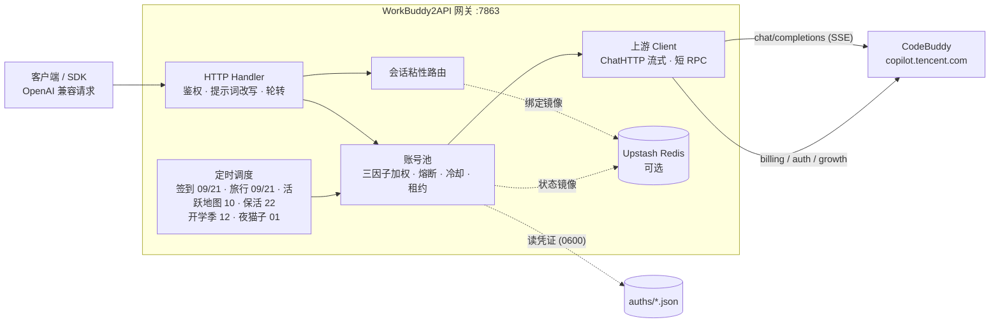

> [!NOTE]
> **延续仓库**：原上游 [Sliverkiss/workbuddy2api](https://github.com/Sliverkiss/workbuddy2api) 已于 2026-09-24 从 GitHub 消失（删除或转私有）。本仓库是其完整历史的延续副本（含上游最后的公开提交 `9a26ae7`），按原项目的 **MIT License** 继续维护，原始版权声明见 [LICENSE](LICENSE)。

<p align="center">
  
</p>

<h1 align="center">WorkBuddy2API</h1>

<p align="center">
  <b>把 CodeBuddy 账号变成 OpenAI 兼容 API 的多账号网关</b><br>
  OAuth 登录 · 账号池轮转 · 熔断与冷却 · 会话粘性 · 积分补充
</p>

<p align="center">
  
  
  
  
  <a href="https://t.me/sliverkiss_blog"></a>
</p>

- 🔐 **OAuth 登录** — 通过 `/v2/plugin/auth/state` 设备授权流程获取凭证，支持 token 自动刷新
- 🔄 **多账号轮转** — 三因子加权随机选号（credits ×闲置×成功率），防热点 + 防惊群（100ms 窗口）
- 🛠 **工具调用** — 完整支持 OpenAI tools/tool_choice，流式 `tool_calls` 按 index 合并
- 📡 **流式 + 非流式** — 上游 SSE 透传；非流式本地聚合（上游拒绝非流式请求）
- ⏰ **定时签到** — 每日 09:00 / 21:00 自动签到 + 积分查询，积分耗尽账号次日 04:00 自动恢复
- 📊 **积分监控** — `credit.sh` 一键查询全部账号剩余/总量/百分比
- 🔑 **登录工具** — `login.sh` 交互式登录，落盘即生效
- 🏗 **Docker 部署** — 一键 `docker compose up`，healthcheck 常驻
- 📈 **请求级日志** — 每个 `/v1/chat/completions` 请求打表格日志（seq/TTFB/uid/tokens/latency）
- 🏥 **健康检查** — `/healthz` 无健康账号时返回 503，可接负载均衡器
- 📉 **状态汇总** — `/status` 返回 total/healthy/cooling/disabled 计数 + 每账号完整画像
- 🧭 **管理页面** — `/admin` 查看账号、发起 OAuth 登录、删除凭证，完成后热加载无需重启

---

## 项目简介

WorkBuddy2API 是一个自托管的 **OpenAI 兼容上游网关**，将 ```CodeBuddy``` 账号包装为统一的 `/v1/chat/completions` 服务。

### 交流群组
- [@checkinHome](https://t.me/checkinHome)

### 本项目做什么

- 通过 **OAuth 设备授权**（`login.sh`）获取账号凭证，在网关侧做 token 自动刷新、账号池调度与流量治理；
- 面向 **个人多账号** 场景：多账号共享、单号故障自动换号、冷却 / 熔断防止雪崩、会话粘性保证多轮上下文不跳号；
- 对客户端只暴露 OpenAI 兼容接口，现有 SDK / 前端 / 工具 **零改造接入**。

### 本项目不做什么

- **只做上游网关，不做下游协议转换** — 本项目仅负责对接上游 ```CodeBuddy``` 并暴露 OpenAI Chat 协议；Anthropic Messages、Gemini 等其他协议的适配应由下游网关负责；
- **不内嵌 Web 管理面板** — 网关核心保持精简，可视化面板作为独立项目维护，数据直取上游接口，不增加网关适配负担。

### 社区前端面板

需要 Web 管理面板的用户，可部署以下符合本理念的社区项目（独立维护，与网关解耦）：

- [workbuddy2api-gui](https://github.com/287775856/workbuddy2api-gui) — 账号池状态可视化面板
- [workbuddy-manager](https://github.com/ithtelab/workbuddy-manager) — 账号管理工具

> ⚠️ 合规须知：本项目是**非官方**网关，使用 ```CodeBuddy``` 账号作为上游，**仅限本人授权账号、本机 / 私有环境测试**。详细边界见[安全与合规](#安全与合规)。

📖 完整文档见 [GitHub Wiki](https://github.com/Sliverkiss/workbuddy2api/wiki)。

## 核心能力

### 账号池治理

- **OAuth 设备授权登录** — `login.sh` 一条命令完成：取授权 URL → 浏览器登录 → token 轮询 → 凭证落盘 → 重启加载，全程无 PKCE（state 由服务端签发），重复执行即可连续添加多账号
- **三因子加权随机选号** — `credits 比例 ×10 + 快过期积分占比 ×8 + 闲置补偿` 三项加权（`pool.expiring_soon` 窗口内的积分优先消耗，默认 7 天），按权重降序取 **Top-5 候选短名单**，再在短名单内加权抽签（等权重候选先随机打乱防惊群、LRU 兜底覆盖全部候选），兼顾积分多、快过期积分先用掉、闲置久的账号；失败账号由熔断 / 冷却 / 连败降权状态机处置（不进权重公式）
- **防惊群** — 跳过 100ms 内刚被选中的账号，多账号同时待命时不打爆同一台
- **在途租约** — 单账号最大在途请求数（`pool.max_in_flight`）限制并发占用，占满的号不参与选号，避免单号过载
- **账本择优** — 每次成功请求按 `usage.credit` 折算每千 token 单价记入 `(账号, 模型)` 账本，免费 / 便宜的账号优先；观测按 EMA 平滑、6 小时未更新即失效（陈旧价格不复活），成本随上游活动实时变化；账本随池状态落盘 `state.json`，重启不丢学费；`/status` 透出 `model_costs` 台账（模型 / 单价 / 末次观测 / 样本数）
- **成本分层条件探索** — costTier 硬过滤（免费 > 未知 > 收费）会把全池锁死在唯一的实测免费号上：其余账号永远轮不到、也就永远学不到「它其实也免费」（垄断 + 学习冻结，issue #136）。破解方式是**搭车改道**：tier 0 垄断层存在且 tier 1 有成员时，距上次探索 ≥ `pool.cost_explore_interval`（默认 30m，`"0"` 关停）就把本次选号改道给一个未知号——承接的是完整真实用户请求，**零新增上游请求**（IP 维度零增量，WAF 友好）。成功即毕业（首观测入账，免费回 tier 0 / 收费出局 tier 2，学费只付一次）；失败走既有冷却 / 熔断策略，无探测风暴。探索频率硬性限幅 ≤ 48 次 / 天 / 模型（24h ÷ 30m），与池规模和 QPS 无关；tier 1 枯竭后自动停探。探索节奏按 `(域, 模型)` 独立；`/status` 透出 `cost_explore` 台账（累计事件数 + 各 (域, 模型) 最近探索时刻），与 `model_costs` 行对照即可读出「探索 → 毕业」全链路

### 流量治理

- **分级熔断与冷却** — 429 软冷却（600s 起指数退避、封顶 `soft_rate_max`）、404 固定浅冷却、402 / 余额耗尽硬冷却至次日 04:00、连续失败熔断（`breaker_threshold` 触发后指数退避封顶 6h）
- **模型级限流独立冷却** — 6004（该模型使用量超限）只冷却触发调用的模型，切其他模型立即可用；`/status` 透出 `rate_limited_models` 台账
- **当日积分预算闸**（`budget.daily_credit_limit`，缺省 `0` = 不限）— 给「跑飞的客户端 / 忘了关的脚本」装一道钱闸：当日累计扣费达到上限后，网关直接拒掉后续对话请求（`429` + `daily_budget_exceeded`，错误文案带上已用与上限），把积分损失截断在阈值附近。计数按 **CST 自然日**重置（与上游增长体系同口径），进程内不落盘、重启清零。只统计上游 `usage` 给出 `credit` 的请求（缺观测不计入，与成本账本同一纪律），所以当日用量是一个**下界**、真实日耗只会更多——阈值宜按保守值设；也可以先留 `0` 当观察模式跑几天，看 `/status` 里 `daily_budget.used` 的真实日耗再定值。闸在**读请求体之前**判定（被拒的请求不会被白读进内存），且**不改变选号**——它只决定「这一枪开不开」，不做「换便宜号」的降级。实时台账（当日已用 / 上限 / 当日被拒次数 / 归属日）在 `/status` 的 `daily_budget`
- **账号临时停用 / 恢复** — 运维可把某个号临时摘出选号池、观察后再放回，不必删凭证（issue #138/#118）。语义是「对话流量摘除」而非「账号冻结」：停用期间签到、token 保活、排程任务照常执行，账号仍在池里、状态照常透出。与系统自动禁用是**两个独立状态位**（`manual_disabled` / `disabled`），各自清除、都清空才回到选号池——避免运维意图被签到解冻等自动复活路径意外解除；停用状态随池状态落盘，重启保留。入口：`/admin/accounts/{uid}/{disable,enable,revive}` 端点 + `cmd/acct` CLI（默认关闭，`admin.enabled` 显式开启）
- **状态持久化** — 池状态（积分 / 冷却 / 熔断 / 计数）本地原子落盘 `state.json`，可选镜像至 Upstash Redis，重启后择优恢复

### 可观测与告警

- **Prometheus 指标端点**（`metrics.enabled`，缺省关闭）— 开启后暴露 `GET /metrics`（Prometheus 文本格式 0.0.4），一次抓取即可拿到账号池规模与各状态分布、在途请求数、会话粘性绑定数、成本探索累计触发次数、WAF IP 拦截是否生效，以及按模型的请求数（成功 / 失败）、流式请求数、token 与缓存 token（命中 / 未命中 / 写入）、积分消耗、首字节与端到端平均耗时、生成吞吐。池维度按 realm（`cn` / `global` / `all`）拆分，指标名与标签值固定顺序输出，逐次抓取结果稳定可比、对不上口径时能直接 diff。口径与 `/status` 同源（同一次聚合，不存在两套数），只暴露聚合量——不含账号 uid、token 等敏感维度；开启后仍受 `api_key` 鉴权保护，与 `/status` 同级。另有 `wb2api_task_*` 一族，输出每类定时任务的**最近一轮**（执行时间戳、各结果计数、是否全灭），只对跑过的任务输出序列
- **可用性阈值告警**（`alerting.enabled`，缺省关闭）— 开启后按 `alerting.interval_seconds`（默认 30s）周期评估池健康度，越界即向 `alerting.webhook_url` 投递 JSON；填 `alerting.secret` 则对请求体做 HMAC-SHA256 签名（`X-WB2A-Signature` 头），接收端可校验来源。三类规则：**健康账号数不足**（按域分别设阈值，`min_healthy_cn` 默认 1、`min_healthy_global` 默认 0 = 不评估该域，纯 CN 部署不会因国际版为空而常驻误报）、**熔断账号数超限**（`breaker_threshold`，默认 0 = 不评估）、**WAF IP 拦截生效**（旋转失败的快速失败信号）。触发是**边沿触发**：连续满足 `alerting.for_ticks` 拍才投递一次，持续越界期间不重复刷屏；恢复需连续满足 `alerting.clear_ticks` 拍才解除（迟滞防抖），解除后可再次触发，不会在临界点来回抖动。`alerting.startup_grace_seconds`（默认 30s）内不评估，避开启动初期账号尚未同步的空池假告警；`alerting.send_resolve` 可额外投递恢复通知。投递超时（`alerting.timeout_seconds`，默认 5s）不阻塞主流程，通知内容不含任何凭证
- **管理操作审计**（`admin.audit_enabled`，缺省关闭）— 开启后 `/admin` 下每个动作（账号停用 / 恢复 / 复活、手动补跑任务）都向 `admin.audit_file`（默认 `./data/admin_audit.log`）追加一行 JSONL，记下**何时、对谁、做了什么、结果如何、从哪来**：时间戳、动作名、对象（账号 uid 或任务名）、响应状态码、来源 IP、`api_key` 指纹，以及停用时填写的理由。用来回答「这个号是谁停的、什么时候停的、为什么」——池状态里的 `manual_reason` 只保留**最新**一条，改动历史只在这里。几处刻意取舍：**只记通过鉴权的请求**（匿名探测不落盘——否则任何人都能靠刷 `/admin` 写满运维的磁盘）；**`api_key` 只存不可反推的指纹、不存原文**；**每条记录独立开-写-关**，故外部 `logrotate` 轮转后进程会自动写新文件，不会继续写进已被移走的旧文件而静默丢失；**审计写失败只告警、不失败请求**（磁盘满时管理操作照常完成——操作结果本身已落在池状态里，而「审计写不进去就拒绝操作」会把一次磁盘故障升级成「坏账号摘不掉」）。路径不可写会在**启动时**直接报错退出，不拖到第一次管理操作才发现。需与 `admin.enabled` 同时开启（审计的对象就是这些端点）

### 请求链路

- **流式 + 非流式** — 出站强制 `stream:true`；SSE 帧按 OpenAI 规范白名单重建；非流式由本地聚合为单响应
- **DeepSeek 思维链注入** — 出站请求体注入 `thinking.type=enabled` + 默认档位，`reasoning_content` 多轮回填，`reasoning_effort` 按模型档位自动降级
- **系统提示词三模式**（`prompt.mode`，缺省 `passthrough`） —
  - `passthrough`（缺省）：透传客户端原始 system，遇内容拦截自动降级中性提示词重试
  - `custom`：网关用自有提示词**替换**客户端 system/developer（从源头消除模板句误报；不参与降级）
  - `append`：**两者并用**——开头连续 system/developer 块之后插入网关自有提示词，客户端项目规范/工具约定与网关人格共存（issue #129）；降级期与拦截首遇重试时退化为 `custom` 语义（换中性提示词，原文 system 移除）
  - `prompt.file`（custom/append 生效）指向自定义提示词文件，空 = 内置默认
- **会话头族注入** — 出站携带官方客户端会话头族（`X-Conversation-Request-ID` 聚合主键 · `X-Conversation-ID` 透传 · B3 链路），轮转 / 重试 / 路径回退复用同键，后台按对话轮聚合不再碎片化（issue #35）
- **指纹脱敏** — 出站请求体黑名单指纹字段清洗（可开关），与提示词体系两层叠加

### 选号语义

选号 = 会话粘性（命中即定）→ 成本分层（硬过滤）→ 加权随机（软均衡）三层串联，各层语义：

- **成本分层** — 账本把每个 `(账号, 模型)` 归入三档：**tier 0**（实测免费，单价 ≤ 0）、**tier 1**（无观测）、**tier 2**（实测收费）。同一次选号在**存活的最便宜档内**选：有 tier 0 就只在 tier 0 里挑，全池无免费观测才落到 tier 1，再不行才是 tier 2——即「贵号永远只作兜底」。tier 1 的号**不会被跳过**：新账号 / 新模型没跑过就没有观测，直接淘汰会把新号饿死。观测随 `usage.credit` 实时更新且 6 小时过期，所以限免窗口（如夜间免费）一结束，账号回到 tier 1 / tier 2，选号自动跟随——无需重启，日志会打 `free tier ended` 提示价格切换
- **会话粘性** — 同一对话固定走同一账号（多轮上下文不跳号、上游 prompt cache 不碎）。粘性键按此优先级取：**conversation 维度四键**（`metadata.conversation_id` / `metadata.conversationId` / `conversation_id` / `conversationId` 任一）→ **`prompt_cache_key`**（pi-ai 系客户端把会话 ID 放在这个 OpenAI 前缀缓存字段里）→ **首条 user 消息文本的 sha256 兜底**（OpenAI 兼容协议无会话 ID 字段，dsh / Codex 等客户端四键全缺，此前粘性恒不命中、逐请求换号；现由首条 user 消息派生会话级稳定键——会话内历史追加不影响该键，开新会话自然换键）。`user_id` **不是**粘性键——它会把一个用户的所有并行对话钉到同一个号上（粒度远粗于上游对话级缓存边界），发 `user_id` 的客户端回落加权轮换（**该回落同样适用于首条 user 消息兜底**：请求体带 `metadata.user_id` 或顶层 `user_id` 时不派生兜底键）。绑定 30 分钟滚动续期，空闲即过期释放
- **负载分布** — 粘性与分层都未限定时，三因子加权随机（`credits ×10 + 快过期积分 ×8 + 闲置补偿`）把流量摊开：高余额号多扛、快过期积分的号先用、闲置号补位；防惊群跳过 100ms 内刚选中的号。权重是**概率倾斜**而非硬排序（Top-5 短名单 + 名单内抽签），不会让单一账号垄断流量

### 定时积分任务

- **签到**（09 / 21 点）— 每日签到 + 余额查询，余额恢复自动解冻冷却账号
- **活跃地图**（10 点）— 对话事件连发上报点亮活跃地图与连登天数、解锁领养前置，补签卡保连登、连登档位兑换 + 抽奖、礼包/补偿领取，回读 streak 自检
- **猫猫旅行**（09 / 21 点）— 独立排程：领养 / 派出 / 领奖闭环推进
- **token 保活**（22 点）— 全账号刷新 token，session 失效连续 3 次才禁用
- **开学季任务**（12 点）— 任务点亮 + claim + 自动抽空抽奖余额，活动下线时自动跳过
- **夜猫子任务**（01 点）— 夜猫窗口（23:00–08:00 CST）内补一次 black_cat 任务

六类任务独立排程、独立开关（`schedule.*_enabled`），互不影响。

**触发时刻可抖动**（`schedule.jitter_minutes`，缺省 `0` = 精确整点）：六个时点默认精确落在整点（迁移自系统 crontab 的 `0 9 * * *` 语义），于是每次到点都是整点齐发。设为正值后，每类任务的触发时刻在该窗口内取一个偏移，把负载摊开、对 WAF 更友好；窗口按**分钟**计，例如 `30` 表示实际触发落在名义时点之后 0–30 分钟内。偏移是**确定性**的——同一任务、同一天、同一小时永远得到同一个偏移（按「任务名 + 日期 + 小时」散列派生），因此不会重复触发同一个时点，重启后当天的节奏也保持一致；换一天则换一个偏移，不会形成新的固定规律。**注意默认种子不含实例身份**：同一任务、同一天、同一小时下，所有用同一份配置的部署会算出**同一个**偏移——整点齐发只是被平移成一个固定的新齐发点。想让各部署真正错开，把 `schedule.jitter_salt` 设成各部署不同的字符串（缺省空串 = 与引入该字段前逐字一致，零行为变化；非空时参与散列，仅影响偏移取值）。窗口大于相邻时点间隔时（如 9 点与 10 点相隔 60 分钟），任务的实际先后可能与配置的小时顺序不一致——这是摊开负载的必然代价。

**错过窗口可手动补跑**：窗口被错过时（服务刚重启、上游当时抖动、刚加完号）不必干等到下一个整点——`POST /admin/tasks/{name}/run`（`name` ∈ `checkin` / `activity` / `keepalive` / `travel` / `school` / `cat`）立即受理并让网关在后台补跑一次。受理是**异步**的（回 202，命令不等任务跑完——这些任务遍历全池打上游、部分还起 python 子进程，耗时可达分钟级），进度看网关日志；同一任务已有一趟在跑时回 409，避免连点对上游重复写。**零上游增量**：只是把既有任务提前跑一次，不新增任何自动上游请求。需 `admin.enabled`（与账号管理端点共用开关与 `api_key`），入口另有 `./acct.sh task <name>`。

**任务执行台账**（`schedule.ledger_file`，缺省空 = 只在内存）：每类任务跑完一轮都记一笔——触发来源（`schedule` 定时 / `retry` 自动补跑 / `manual` 人工）、起止时刻与耗时、本轮涉及多少账号，以及其中成功 / 已做过 / 失败 / 跳过各多少，外加「本轮是否全灭」。`/status` 的 `task_ledger` 段（`runs` + `retry`）直接读它，于是「昨天 21 点的签到到底跑没跑、跑了几个号、失败几个」不用再翻日志；`/metrics` 也据此输出 `wb2api_task_last_run_timestamp_seconds`、`wb2api_task_last_run_accounts{kind,result}`、`wb2api_task_last_run_all_failed`（只对跑过的任务输出序列——否则每次部署都会多出一条「从未跑过」的假告警）。填了路径就顺带落一份 JSON 文件，重启后仍能看到上一轮结果；**写盘失败只打日志、不拦任务**——台账是观察，不是安全承诺，这一点与 admin 审计日志的 fail-fast 刻意相反。计数按 CST 自然日滚动，跨日后的下一次访问自动归零。

**当日失败重试**（`schedule.retry_delay_minutes`，缺省 `0` = 关闭；`schedule.retry_max_per_day`，缺省 `1`）：一轮跑完**有失败且一个都没做成**（`ok + already == 0`）时，视为上游整体不可达（网络/DNS 未就绪、上游抖动、WAF 拦截），延迟 `retry_delay_minutes` 分钟自动补跑一次。判据刻意**不是**「失败率超阈值」：只要还有账号成功就证明上游是通的，失败是账号级的（单号 token 过期、被限流），重试只会对同一批注定失败的号再打一遍上游——既无收益，又正好撞在本仓库一直避免的风控上。`retry_max_per_day` 是每类任务的**当日上限**，计数在**排定时**就 +1（不是跑完才 +1），所以重试排上之后即使服务重启也不会重复排、更不会对上游重复写；达到上限或延迟跨到了次日，只打一条 WARN 说明原因。人工触发（`/admin/tasks/{name}/run`）**不排重试**——运维刚点过一次，自己会判断要不要再点，自动重跑会让一次人工操作静默变成两次上游写。**缺省关闭，且开启后成功路径依旧零新增上游请求。**

### 双域适配

- 同时适配**国内版（CN，`copilot.tencent.com` / `www.codebuddy.cn`）与国际版（Global，`www.workbuddy.ai`）**账号
- 共享同一账号池，由账号 `realm` 或请求模型名前缀（`cn:` / `global:`）决定路由；`global.enabled` 可一键锁死纯 CN 部署
- 国际版支持注册激活、地区完善、一次性 trial 加油包领取（`./trial.sh`）

### 辅助工具

- 积分日报：`./credit.sh`（美化 / `-json`，realm 感知双域）
- 手动签到：`./signin.sh`（批量、幂等不重复计）
- 账号停用 / 恢复：`./acct.sh list | disable <uid> [原因] | enable <uid> | revive <uid>`（需 `admin.enabled`，走网关管理端点）
- 手动补跑排程任务：`./acct.sh task <任务名>`（异步受理，同任务在跑时回 409；需 `admin.enabled`）
- 领养联动 / 任务查询：`scripts/task_runner.py`（成长任务一体机，默认 dry-run）
- 个性化提示词：`prompt.file` 指向自定义提示词文件即整体替换内置默认（`custom`/`append` 模式生效）

### 仓库自动化（AI 治理）

仓库的 issue / PR 由 `.github/actions/ai-governance` 自动分级与归并：垃圾检测、README 覆盖检查、
分类打标、要点提炼、canonical 归并；PR 侧另有关联记录与历史语境评审。AI 后端用仓库 Secrets
`AI_BASE_URL` / `AI_API_KEY` / `AI_MODEL` 指向任意 OpenAI 兼容端点。

> **提 PR 前请看 [贡献与 PR 要求](#贡献与-pr-要求)**：本仓库的 PR 会被 AI 自动打标、规范化标题、
> 关联 canonical，**通过闸门后会直接自动合并**；不满足要求的会被判 `TRIVIAL` / 垃圾并自动关闭。

- **自动审核**：PR 创建时自动跑垃圾检测、标题规范（Conventional Commits）、质量判定、分类打标、
  历史语境评审，并在正文顶部追加自动维护的关联块（`<!-- ai-governance:linked -->` 锚点，请勿删除）。
- **自动合并**（`enable-auto-approve`）：通过闸门的 PR（分层检测 KEEP + 改动不含 CI / 构建 / 依赖 /
  脚本类文件 + 规模在上限内）会被打上 `ai-approved` 标签，由 `PR Auto-merge` 工作流启用仓库原生
  auto-merge —— **必须在 PR CI（`test` 检查）通过后才合并**；PR 有新提交会自动撤销批准，需重新评审。
  维护者叫停：摘掉 `ai-approved` 标签并关闭 auto-merge 即可。
- **人工重跑**：Actions → AI Governance → Run workflow，填 `issue-number` 或 `pr-number`（二选一）
  即可对既有内容重跑同一条治理链路；两者都留空时只告警、不做任何处理。
- **维护者豁免**：`maintainer-exempt`（默认开）让协作者提交的内容跳过归并 / 重开与自动合并，
  只保留垃圾检测与分类打标。
- **先行演练**：`dry-run` 只评论不写入，用于上线前观察判定质量。

## 架构总览



上游请求在出站前经历统一的改写管线（`internal/upstream/payload.go`）：强制 `stream:true`、`developer` 角色归一、tool_choice 归一、`image_url` 字符串兼容为 OpenAI 对象形态、DeepSeek 思维链注入、`reasoning_effort` 档位降级、`reasoning_content` 回填、指纹脱敏。

## 快速开始

### 环境要求

- **Docker + Docker Compose**（推荐部署方式，镜像内已含 `app` 低权限用户与全部工具脚本）
- 一个或多个已注册的 CodeBuddy 账号，用于 OAuth 登录
- 宿主机 Go ≥ 1.22（仅源码构建时需要）

### Docker Compose 一键部署

```bash
git clone https://github.com/Sliverkiss/workbuddy2api.git
cd workbuddy2api
cp config.example.json config.json
```

编辑 `config.json`，**至少设置 `api_key`**（`留空 = 不鉴权`，公网部署务必设置）。示例中的 `test_key` 等均为占位符，`config.example.json` 不含任何真实密钥。

```bash
# 登录添加账号（重复执行可加多号；注意：执行过下方说明中的 chown 后，
# host 侧 login.sh 会被可写性预检拦截——此时请在容器内登录，见下方说明）
./login.sh

# 启动服务
docker compose up -d --build

# 健康检查（无可用账号时 503）；service 字段用于确认打到的是本网关
curl -s http://localhost:7863/healthz
# {"healthy":2,"total":3,"service":"workbuddy2api"}
```

`login.sh` 内置授权 URL 获取 + 浏览器登录 + token 轮询 + 首次签到 + `auths/workbuddy-<uid>.json` 落盘 + 容器重启，全程无 PKCE（state 由服务端签发）。账号池在容器启动时用 `auths/` 目录自动对齐，新增凭证文件即自动发现。

> **国内网络下构建会卡在第一层**：镜像构建的第一步是 `go mod download`，默认走官方
> `proxy.golang.org` —— 中国大陆不可达，表现为长时间停在这一层（看着像构建挂了），
> 有时直接失败。换个国内代理即可：
>
> ```bash
> docker compose build --build-arg GOPROXY=https://goproxy.cn,direct
> docker compose up -d
> ```
>
> 也可以直接填进 `docker-compose.yml` 的 `build.args.GOPROXY`。留空 = 官方默认，
> 与改动前行为一致。

> **非 root 宿主用户注意**：`./login.sh` 以**当前宿主用户**落盘凭证（权限 0600），而容器内网关以 `app(uid 10001)` 读 + 回写（refresh / realm 补标识走 tmp+rename，需要目录写权限）。二者 uid 不同（例如 Linux 非 root 账号通常是 uid 1000）时容器读不到凭证文件，`/status` 账号数为 0——与 `./data` 卷的属主问题同源。登录后、启动前把目录属主交给 10001（root 或部署用户执行）：
>
> ```bash
> chown -R 10001:10001 ./auths
> ```
>
> 之后新增账号**必须**进**容器内**登录（`app` 自身落盘，属主即 10001，无需反复 chown；chown 后 host 侧 `./login.sh` 无写权限，脚本会在启动浏览器授权前直接退出并提示，不会白走一遍 OAuth。容器内无 docker CLI，完成后回宿主机重启）：
>
> ```bash
> docker compose exec -it wb2api bash -c './login.sh' && docker compose restart wb2api
> ```

### 源码构建

```bash
go build ./...
go vet ./...
go test ./...      # 完整测试套件
go run ./cmd/server -config config.json
```

构建二进制：

```bash
CGO_ENABLED=0 go build -trimpath -ldflags="-s -w" -o wb2api ./cmd/server
CGO_ENABLED=0 go build -trimpath -ldflags="-s -w" -o signin_bin ./cmd/signin
CGO_ENABLED=0 go build -trimpath -ldflags="-s -w" -o login ./cmd/login
CGO_ENABLED=0 go build -trimpath -ldflags="-s -w" -o credit ./cmd/credit
```

#### Windows 原生运行（无需 Docker）

Windows 10/11 自带的 PowerShell 与 `curl.exe` 即可管理后台进程。先准备配置并构建：

```powershell
Copy-Item config.example.json config.json
# 编辑 config.json；建议把 listen 设为 127.0.0.1:7863，且务必设置 api_key

go build -trimpath -ldflags="-s -w" -o wb2api.exe ./cmd/server
go build -trimpath -ldflags="-s -w" -o login.exe ./cmd/login
go build -trimpath -ldflags="-s -w" -o signin_bin.exe ./cmd/signin
go build -trimpath -ldflags="-s -w" -o credit.exe ./cmd/credit
```

使用仓库自带脚本在后台启停并查看状态：

```powershell
.\start-workbuddy2api.cmd
.\status-workbuddy2api.cmd
.\stop-workbuddy2api.cmd
```

PID 写入 `wb2api.pid`，标准输出与错误日志分别写入 `data/server.out.log`、
`data/server.err.log`。停止脚本会先验证 PID 对应的可执行文件确为当前目录下的
`wb2api.exe`，不会因陈旧 PID 误杀其他进程。

添加账号可使用配套管理面板，或在 Git Bash 中运行现有 `login.sh`（它还负责 CN
首次签到以及 Global 注册地区/trial 流程；不建议只手工调用 `login.exe` 后跳过这些步骤）。

### 验证

```bash
# 模型列表
curl -s http://localhost:7863/v1/models -H "Authorization: Bearer your-api-key"

# 账号状态（汇总 + 每账号详情，含 disabled / manual_disabled 双位）
curl -s http://localhost:7863/status -H "Authorization: Bearer your-api-key"

# 临时停用一个账号（需 config 里 admin.enabled = true）
curl -s -X POST http://localhost:7863/admin/accounts/<uid>/disable \
  -H "Authorization: Bearer your-api-key" -H "Content-Type: application/json" \
  -d '{"reason":"观察几天"}'
# 或用 CLI（自动从 config.json 读网关地址与 key）
./acct.sh list && ./acct.sh disable <uid> 观察几天 && ./acct.sh enable <uid>

# 流式聊天
curl -sN http://localhost:7863/v1/chat/completions \
  -H "Authorization: Bearer your-api-key" \
  -H "Content-Type: application/json" \
  -d '{"model":"deepseek-v4-flash","messages":[{"role":"user","content":"hi"}],"stream":true}'

# 非流式聊天（本地聚合）
curl -s http://localhost:7863/v1/chat/completions \
  -H "Authorization: Bearer your-api-key" \
  -H "Content-Type: application/json" \
  -d '{"model":"deepseek-v4-flash","messages":[{"role":"user","content":"hi"}],"stream":false}'
```

### 管理凭证

打开 `http://localhost:7863/admin`，输入与 API 相同的 Bearer key，即可查看账号、添加 OAuth
凭证或删除凭证。管理 API 始终复用 `api_key`；公网部署建议再用 TinyAuth 只保护
`/admin`，并明确让 `/v1/*`、`/status`、`/healthz` 绕过 TinyAuth。

OAuth 完成后账号会直接热加载到运行中的池，无需重启容器。

### Hermes Agent 会话粘性

Hermes 默认不会把内部 session id 放入 OpenAI 请求体。启动 Hermes 时开启已有的 session
标识注入：

```bash
hermes --pass-session-id
```

TUI/桌面网关可设置：

```bash
export HERMES_TUI_PASS_SESSION_ID=1
```

服务会从开头的 system/developer prompt 中识别 `Session ID: ...`，并以它作为粘性会话键。
显式的 `metadata.conversation_id` / `conversation_id` 仍具有更高优先级。

### GHCR 镜像

仓库内 GitHub Actions 会运行测试并发布单架构 `linux/amd64` 镜像：

```text
ghcr.io/<fork-owner>/workbuddy2api:latest
```

workflow 不启用 QEMU，也不构建 `linux/arm64`。

## ⚙️ 配置说明

完整字段以 [`config.example.json`](config.example.json) 为样例（下表为各字段含义）。

```json
{
  "listen": ":7863",
  "api_key": "your-api-key-here",
  "auth_dir": "./auths",
  "state_file": "./data/state.json",
  "cooldown": { "soft_rate": "600s", "soft_rate_max": "2h" },
  "schedule": {
    "checkin_hours": [9, 21],
    "keepalive_hours": [22],
    "checkin_enabled": true,
    "keepalive_enabled": true
  },
  "upstream": {
    "timeout_seconds": 120,
    "header_timeout_seconds": 120,
    "idle_timeout_seconds": 300
  },
  "features": { "sanitize_blacklist_fingerprints": true },
  "upstash": { "url": "", "token": "" },
  "pool": {
    "max_in_flight": 3,
    "breaker_threshold": 3,
    "breaker_cooldown": "30m",
    "breaker_cooldown_max": "6h",
    "idle_weight_per_hour": 0.5,
    "idle_weight_max": 5.0
  },
  "session_sticky": { "enabled": true, "ttl": "30m", "gc_interval": "5m" }
}
```

### 字段速查

| 字段 | 默认 | 说明 |
|---|---|---|
| `listen` | `:7863` | HTTP 监听地址 |
| `api_key` | 空 | 网关鉴权密钥；**空 = 不鉴权直接放行**（公网必须设置） |
| `auth_dir` | `./auths` | 账号凭证目录 |
| `state_file` | `./data/state.json` | 账号池状态持久化文件 |
| `cooldown.soft_rate` | `600s` | 软限流（429/限流文案）冷却**基数**；同一账号连续触发按 2 倍指数退避 |
| `cooldown.soft_rate_max` | `2h` | 软冷却指数退避的封顶时长 |
| `schedule.checkin_hours` | `[9, 21]` | 每日本地时区整点签到 + 余额查询；收尾顺带跑一趟猫猫旅行。**空数组/`null` = 未配置回落默认**（不是禁用） |
| `schedule.keepalive_hours` | `[22]` | 每日本地时区整点刷新 token 保活。空数组/`null` 同上 |
| `schedule.checkin_enabled` | `true` | 签到**总开关**；`false` 真正关掉签到（**猫猫旅行随之停摆**，见下） |
| `schedule.keepalive_enabled` | `true` | token 保活总开关；`false` 关掉保活 |
| `upstream.timeout_seconds` | `120` | 短 RPC（刷新/签到/余额/模型）总时长上限 |
| `upstream.header_timeout_seconds` | 回落 `timeout_seconds` | 聊天首字节前（响应头）上限 |
| `upstream.idle_timeout_seconds` | `300` | 聊天流中空闲上限（活跃续命，静默断流） |
| `features.sanitize_blacklist_fingerprints` | `true` | 出站请求体黑名单指纹脱敏 |
| `upstash.url` / `token` | 空 | 空 = 纯内存模式（Noop 降级，功能照常） |
| `pool.max_in_flight` | `3` | 单账号最大在途请求数（`0` = 不限） |
| `pool.breaker_threshold` | `3` | 连续失败触发熔断阈值 |
| `pool.breaker_cooldown` | `30m` | 熔断基础退避时长 |
| `pool.breaker_cooldown_max` | `6h` | 指数退避封顶 |
| `pool.idle_weight_per_hour` | `0.5` | 闲置补偿：每小时未使用 +0.5 权重 |
| `pool.idle_weight_max` | `5.0` | 闲置补偿权重封顶 |
| `session_sticky.enabled` | `true` | 会话粘性路由开关 |
| `session_sticky.ttl` | `30m` | 会话绑定 TTL（滚动续期） |
| `session_sticky.gc_interval` | `5m` | 过期绑定 GC 周期 |

### 上游超时语义（三段各归其位）

| 字段 | 作用对象 | 默认 | 行为 |
|---|---|---|---|
| `timeout_seconds` | 短 RPC（token 刷新 / 签到 / 余额 / 模型列表） | `120` | 总时长硬上限，到期报错走换号/熔断 |
| `header_timeout_seconds` | 聊天 SSE **首字节前** | `120` | 由 `Transport.ResponseHeaderTimeout` 约束；超时 = 换号重发 |
| `idle_timeout_seconds` | 聊天 SSE **流中空闲** | `300` | 活跃吐数据**续命**不掐；静默超时才断流释放租约 |

聊天流（`stream` true/false 均同）**没有总时长上限**：聊天使用 `Timeout=0` 的专用 client，长思考/长输出（如超长 reasoning）不会被 120s 掐断。

### 环境变量覆盖

加载顺序：JSON 文件 → `WB2A_*` 环境变量（变量非空才覆盖）：

`WB2A_LISTEN` · `WB2A_API_KEY` · `WB2A_AUTH_DIR` · `WB2A_STATE_FILE` · `WB2A_SOFT_RATE`（duration） · `WB2A_SOFT_RATE_MAX`（duration） · `WB2A_TIMEOUT_SECONDS` · `WB2A_HEADER_TIMEOUT_SECONDS` · `WB2A_IDLE_TIMEOUT_SECONDS` · `WB2A_SANITIZE_FINGERPRINTS`（bool）

## 🧠 账号池与流量治理

### 账号状态机

每个账号由三个正交维度描述：

| 维度 | 字段 | 说明 |
|---|---|---|
| 健康 | `disabled` / `until` / `breakerUntil` | `healthy = !disabled && !until && !breakerUntil` |
| 并发 | `inFlight` | 在途租约（运行态，不持久化），上限 `max_in_flight` |
| 统计 | `successCount` / `errTotal` / `lastUsed` | 供成功率权重与闲置补偿 |

```text
  Healthy ──429/404 软冷却 / 402 硬冷却 / 5xx 熔断──▶ 冷却·熔断期
     ▲                                                │
     │       到期自动恢复 / 签到余额解冻 / 成功清零     │
     └────────────────────────────────────────────────┘

  Disabled（session 死亡，永久，需人工重新 login.sh）
```

### 错误分类与处置

| 分类 | 触发条件 | 账号处置 | 恢复 |
|---|---|---|---|
| 余额不足 | HTTP 402 / body 含余额关键词 | 硬冷却到**次日 04:00**（本地时区） | 签到（09/21 点）余额恢复自动解冻 |
| 频控 | HTTP 429 / 限流文案（不限状态码） | 软冷却 `soft_rate`（600s 起，连续触发指数退避，封顶 `soft_rate_max`） | 到期自动恢复 / 成功清零退避 |
| Session 失效 | body 含 `Offline user session not found` / `12153` | **永久禁用** | 人工重新登录 |
| 上游 404 | HTTP 404 | 软冷却固定 60s（不随 `soft_rate`、不单独退避） | 到期自动恢复 |
| 服务端错误 | HTTP ≥500 | 喂连续失败计数，达阈值熔断 | 熔断到期 / 成功清零 |
| 客户端错误 | 其余 4xx / 业务 `code≠0` | 不处罚，换号重试 | 即时 |

**熔断器**：所有冷却入口（429/404/402）与 5xx 共用唯一连续失败计数器 `fails`；累计达 `breaker_threshold`（默认 3）触发熔断，退避 `breaker_cooldown × 2^retryCount`，封顶 `6h`；成功清零。

**软冷却指数退避**（与熔断器并存的第二条升级线）：软限流的**冷却时长**本身也按连续次数退避——同一账号连续触发软冷却时 `soft_rate × 2^(连续次数-1)`，封顶 `soft_rate_max`。计数 `soft_streak` 独立于熔断器的 `fails`，只在**成功**或**签到解冻**时清零，随 `state.json` 持久化。两者别混淆：软退避管"近期被限流"（600s→1200s→2400s…，分钟~小时级），熔断管"病态反复失败"（30m→1h→2h→6h）。

### 选号策略

1. 过滤：禁用 / 冷却 / 熔断 / 在途占满账号不参与
2. 取 **Top-5** 候选（按三因子权重降序，积分只是因子之一）
3. 三因子加权随机：
   `weight = credits 比例 ×10 + idleWeight + successRate ×3`
   - `credits 比例` = 该号积分 / 候选集最大积分
   - `idleWeight` = `min(闲置小时 × idle_weight_per_hour, idle_weight_max)`，从未使用给满分
   - `successRate` = `successCount/(successCount+errTotal)`，无记录给中性 1.5
4. 防惊群：跳过 100ms 内刚被选中的账号；全冷却时从非禁用、非余额耗尽的软冷却/熔断账号中选最早到期者顶班

### 会话粘性

同一会话尽量复用同一账号，多轮对话不跳号：

- 会话键提取顺序：`metadata.conversation_id` → `metadata.user_id` → 顶层 `conversation_id`
- TTL 滚动续期（默认 30m），GC 周期 5m；绑定可镜像到 Redis（7 天）防重启丢失
- 请求失败自动解绑；成功后绑定跟随最终成功账号

### 定时任务

| 任务 | 开关 | 时刻（本地时区） | 行为 |
|---|---|---|---|
| 签到 | `schedule.checkin_enabled` 默认 `true` | `checkin_hours` 默认 `[9, 21]` 整点 | 签到 + 余额查询；余额恢复则解冻冷却账号；**收尾顺带跑一趟猫猫旅行** |
| 保活 | `schedule.keepalive_enabled` 默认 `true` | `keepalive_hours` 默认 `[22]` 整点 | 全账号刷新 token；session 失效自动禁用 |

容器时区由 `TZ` 控制（compose 默认 `Asia/Shanghai`）。

#### 关闭定时任务

用 `schedule.checkin_enabled` / `schedule.keepalive_enabled` 显式关闭，两者互相独立：

```json
"schedule": {
  "checkin_hours": [9, 21],
  "keepalive_hours": [22],
  "checkin_enabled": false,
  "keepalive_enabled": true
}
```

上例：**只关签到，保活照常 22:00 跑**。两个都设 `false` 则调度器无任何时点可等，
`Run` 不空转、直接阻塞等待退出信号（不会忙等空烧 CPU）。

几条必须知道的语义：

- **为什么用独立开关，而不是把小时数组留空**：空数组与 `null` 在本项目里一贯表示
  **「未配置 → 回落默认」**（`[9, 21]` / `[22]`），不是「禁用」。沿用该语义可保证
  老 config 行为逐字不变；真正关闭请用 `*_enabled: false`。
- **关签到 = 猫猫旅行也停**：旅行没有独立开关，它搭签到时点便车执行（见下节）。
  想让旅行继续跑就不能关签到——如需保留旅行请把 `checkin_hours` 调成你想要的时点。
- **禁用不会擦除小时配置**：`checkin_hours` 原样保留，改回 `true` 即恢复原时点，无需补配。
- **小时值必须是 0-23**：写了 `-1`、`25` 之类的非法值会在启动时**直接报错**并提示改用
  开关（不做静默兜底，避免你以为关掉了、实际却在别的整点照常执行）。
- 开关只影响**本进程的定时排程**，不改变池内冷却/熔断/禁用等既有状态机行为；
  独立的一次性工具（`signin.sh` / `cmd/signin`）是另一个进程，不受本开关约束。
- **关签到的连带影响**：签到的余额查询会「余额恢复即解冻」被硬冷却的账号（402 余额不足），
  关掉后这类账号只能等硬冷却**次日 04:00 自然到期**才回到池中——当日余额回补不再提前解冻。

#### 猫猫旅行（随签到时点合并执行）

对池内每个可用账号在**签到时点（`checkin_hours`，默认 9/21 点）单趟推进一次**，
每趟只做一个动作，不轮询不等待：

**为什么不再单独排程**：每日上限按「派出」计 1 次/天，奖励在派出时即锁定、晚领不丢分；
旅行周期以小时计，30 分钟粒度的额外巡检不会多派一次，只是白白增加上游请求。
合并到签到时点后每账号每天 2 趟，签到 → 派猫 → 领奖一次跑完。
（签到排在旅行之前：先签到解冻冷却账号，本轮旅行才能覆盖到它们。）

| 探测结果 | 动作 |
|---|---|
| 无猫（`buddy` 为 `null`） | 先同意协议（幂等），再尝试领养；过门槛则 +300 积分并获得猫 |
| `state=idle` 且今日未派出 | 派出 `location_id=4`（古镇客栈；4 个地点收益/时长区间相同，无最优解） |
| `state=arrived` | 领取到站奖励（带 `record_id`） |
| `state=traveling` / 今日已达上限 / 未知状态 | 跳过 |

- **领养门槛**：conversation 门槛未达标时上游返回 HTTP 400 `first_buddy task not completed yet`，
  属预期行为——**每账号每自然日只尝试一次**，失败后当日静默跳过，跨日（00:00 CST）自动重试；
  记录仅存内存，进程重启后清零。
- **限速**：账号间间隔 800ms（46 个账号约 40s），避免触发上游风控。
- **每自然日 1 次派出**：按 CST（Asia/Shanghai）自然日重置，与容器 `TZ` 无关。
- **失败隔离**：单个账号查询/动作失败只跳过该账号本轮，不中断其他账号；401 不做强刷
  （token 刷新交 22:00 保活），失败信息按 `travel <uid>: <动作>: <错误>` 落日志。
- **关闭**：旅行无独立开关——它随签到一起跑，不再单独排程。
  因此 **`schedule.checkin_enabled: false` 关掉签到的同时，旅行也一并停摆**；
  只想调整时点（而非关闭）请改 `checkin_hours`。

签到与保活配到同一小时（如都含 22 点）时，两类任务都会执行。

## 🔌 API 端点

| 端点 | 鉴权 | 说明 |
|---|---|---|
| `POST /v1/chat/completions` | Bearer（`api_key` 非空时） | OpenAI 兼容补全；流式/非流式；请求体上限 8 MiB |
| `GET /v1/models` | Bearer（`api_key` 非空时） | 模型列表（动态拉取，缓存 1h；失败回落静态表 + 5min 负缓存） |
| `GET /status` | Bearer（`api_key` 非空时） | 账号状态汇总 + 每账号详情（积分/冷却/熔断/在途/粘性） |
| `GET /healthz` | 无 | 健康检查：有 healthy 且未占满账号返回 200，否则 503；响应带身份标识（见下） |

> 鉴权规则：仅当 `api_key` 非空才校验 `Authorization: Bearer <api_key>`；**`api_key` 为空时上述端点直接放行**；`/healthz` 恒无鉴权。

`/healthz` 响应示例（200/503 同结构，仅状态码与计数变化）：

```json
{"healthy": 2, "total": 3, "service": "workbuddy2api"}
```

响应同时带 `X-Service: workbuddy2api` 头。这两个身份标识用于区分**本网关**与同端口上
可能残留的其他服务——后者即使返回 2xx 也不会带该字段/头，宿主探测据此避免"假成功"。

### 宿主健康探测指引

宿主程序（如 workbuddy-switch 托管网关子进程）探活时，**"端口通 + 返回 2xx" 不足以
证明打到了自己的网关**：同端口可能残留旧版本进程或别的服务，对方返回 2xx 会造成假成功。
按校验强度从高到低有两种做法：

**① 强校验（推荐）：`/status` + `api_key`**

```bash
# 期望 200；若返回 401 则说明对面的 /status 不认这个 api_key —— 不是自己的网关
curl -s -o /dev/null -w '%{http_code}\n' \
  -H "Authorization: Bearer <api_key>" \
  http://127.0.0.1:7863/status
```

`/status` 挂在鉴权中间件上：只有持有正确 `api_key` 的本网关才会返回 200，旧服务/其他服务
只会返回 401（或 404）。**注意前提**：本网关 `api_key` 非空才具备这个判别力；
`api_key` 为空时 `/status` 直接放行，退化为弱校验。

宿主判定建议：`200` → 健康；`401` → 不是自己的网关（端口被占）；连接失败 → 未就绪；
`5xx` → 网关已就位但池不可服务（可再叠加 `/healthz` 的 503 语义）。

**② 弱校验（无凭据场景）：`/healthz` + `service` 字段**

```bash
# 必须同时校验 service 字段；只判断 HTTP 状态码仍可能假成功
curl -s http://127.0.0.1:7863/healthz | grep -q '"service":"workbuddy2api"'
```

适合负载均衡器 / 容器编排这类**不该持有 api_key** 的探活方（`/healthz` 恒无鉴权，
200=可服务、503=池内无可服务账号）。判据是响应体 `service == "workbuddy2api"`；
响应头 `X-Service` 可用于只读头部的探活实现。若对面返回 2xx 但缺该标识 → 判为异常。

> 容器自带的 `HEALTHCHECK` 用的就是 ②（仅进程内自检，够用）；
> 宿主做**跨进程归属确认**时用 ①。

### 流式行为细节

- 出站请求强制 `stream:true`；SSE 帧按 OpenAI 规范**白名单重建**（`reasoning_content` 保留、工具调用按 index 合并、未知字段剥离）
- 保证恰好一个 `data: [DONE]`（上游漏发时兜底补写）；空流先写一帧 `error` 再补 `[DONE]`；`error` 帧原样透传

## 📋 请求级日志

每个 `/v1/chat/completions` 请求结束时输出一行表格日志（stdout）：

```text
| #001 | 18:31:31 | deepseek-v4 | stream | 200 | uid=0851ce35 | TTFB=801ms | tok=60 | 23.5tok/s | total=2.6s |
```

| 字段 | 说明 |
|---|---|
| `#001` | 进程级请求序号 |
| `18:31:31` | 结束时刻 |
| `deepseek-v4` | 模型名（超 11 字符截断） |
| `stream` / `sync` | 请求模式 |
| `200` | 状态码 |
| `uid=0851ce35` | 账号 UID 前 8 位 |
| `TTFB` | 流式首帧耗时（非流式为 `-`） |
| `tok` / `tok/s` / `total` | 输出 token 数 / 速率 / 总时长 |

**敏感度**：日志不含任何 token 明文（详见[安全与合规](#-安全与合规)），无落盘日志文件。

## 🛡️ 安全与合规

### 1. 凭据管理（auths）

- **位置**：`./auths`（`auth_dir` 可配），文件名 `workbuddy-<uid>.json`
- **内容**：明文 `accessToken` / `refreshToken` + 账号元信息，结构见下：

```json
{
  "account": { "uid": "…", "enterpriseId": "…", "nickname": "…" },
  "auth": { "accessToken": "明文", "refreshToken": "明文", "expiresAt": 0, "domain": "" }
}
```

- **权限**：容器内以 `app` 用户（uid 10001）运行；token 刷新由 `SaveAtomic` 以 `0600` 原子写回（tmp + rename）；`login.sh` 首次落盘遵循登录 umask，建议手动 `chmod 600 auths/*.json`
- **备份**：备份 `auths/`（凭证）与 `data/state.json`（池状态：积分/冷却/计数）；配置 Upstash 后状态另镜像至 Redis
- **切勿提交 git**：`.gitignore` 已排除 `auths/`、`data/`、`backups/`、`config.json`、`*.key`、`*.pem`

### 2. 网络暴露与日志敏感度

- 默认监听 `:7863`，compose 暴露 `0.0.0.0:7863`，**无内置 TLS**；公网部署必须设置 `api_key`，建议前置反代/内网
- 请求日志字段：序号/模型/模式/状态码/**uid 前 8 位**/TTFB/token 数——**不含** `accessToken`/`refreshToken`/`api_key` 明文（不读取 `Authorization` 头）
- 日志写 **stdout/stderr**（容器内进入 `docker logs`），代码无任何落盘日志文件

### 3. 上游访问端点清单

| 端点 | 方法 | Host | 用途 |
|---|---|---|---|
| `/v2/chat/completions` | POST | `copilot.tencent.com` | 聊天补全（SSE） |
| `/console/enterprises/personal/models` | GET | 同上 | 动态模型列表 |
| `/v2/plugin/auth/token/refresh` | POST | 同上 | token 刷新 |
| `/v2/billing/meter/daily-checkin` | POST | `www.codebuddy.cn` | 每日签到 |
| `/v2/billing/meter/get-user-resource` | POST | 同上 | 余额查询 |
| `/v2/plugin/auth/state?platform=CLI` | POST | `copilot.tencent.com` | OAuth 取授权 URL |
| `/v2/plugin/auth/token?state=` | GET | 同上 | OAuth 轮询取 token |
| `/v2/plugin/login/account?state=` | GET | 同上 | OAuth 取账号信息 |
| `/activity/growth/buddy/agreement` `first` `info` | POST/GET | 同上 | 猫猫旅行：同意协议 / 首次领养 / 查询 |
| `/activity/growth/buddy/travel/status` `depart` `claim` | GET/POST | 同上 | 猫猫旅行：状态 / 派出 / 领奖（随签到时点执行） |

> 上述 `/v2/*` 端点是 CodeBuddy 官方 CLI/插件使用的接口，**未见公开 API 文档，属非公开/逆向接口**；本项目不主张任何上游接口的官方授权或稳定性承诺。出站统一携带 `CLI/2.63.2 CodeBuddy/2.63.2` UA；聊天请求带账号头（`X-User-Id` 等），**永不携带 `X-Refresh-Token`**。

## 贡献与 PR 要求

**本仓库的 PR 由 AI 自动审核，并在通过闸门后自动合并。** 提交前请按下面的自查清单过一遍 ——
这些要求不是礼节，而是流水线的实际输入：不满足大概率会被判 `TRIVIAL` / 垃圾而自动关闭，
或拿不到自动合并资格（只能等人工）。

### 会自动化发生的事（先知道这些）

| 环节 | 行为 |
| --- | --- |
| 触发 | **只在 PR 创建时**自动评审一次；之后改标题、追加提交都不会自动重跑 |
| 打标 | 自动打一个分类标签（`bug` / `enhancement` / `question` / `documentation`） |
| 改标题 | 标题不符合 Conventional Commits 时**会被 AI 改写**（如 `feat(scheduler): …`） |
| 改正文 | 在正文顶部追加自动维护的块（要点 + 关联的 canonical issue，带 `<!-- ai-governance:linked -->` 锚点）；**请勿删除锚点行**，也不要手工重复它 |
| 关闭 | 垃圾 / 恶意内容 → 关闭并**锁定**；只有测试、无意义或纯占位的改动 → 判 `TRIVIAL` 关闭（不锁定）；与历史结论冲突（重复已合并、或维护者已 wontfix 的改动）→ 附历史依据关闭并打 `history-rejected` |
| 合并 | 通过闸门的 PR 由**仓库原生 auto-merge** squash 合并进 `master`；提交信息取 PR 标题，所以标题要写成一句人话 |
| 身份 | 以上动作由 `github-actions[bot]` 执行。不同意判定就在 PR 下留言并 @ 维护者 —— 维护者可摘掉标签、关闭 auto-merge、或重跑治理 |

### 自动合并的闸门

只有**全部满足**才会被自动合并；缺任何一条都只走人工：

1. **分层检测 `KEEP`**：非垃圾 + 标题符合 Conventional Commits + 质量 `VALID`；
2. **不含敏感路径**（这类改动永远人工合并，绝不自动合）：
   - `.github/**`（CI / 工作流 / Action）—— 自动合并这类改动等于把仓库执行权限交给贡献者；
   - `Dockerfile`、`docker-compose*.yml`、`Makefile`；
   - `go.mod`、`go.sum`（依赖与构建图）；
   - `scripts/**`、任意 `*.sh` / `*.cmd` / `*.ps1`；
3. **规模在上限内**：≤ 20 个文件且 ≤ 800 行改动（超过就只做人工评审）；
4. **CI 绿**：`PR CI` 的 `test` 检查通过 —— 它已设为 `master` 的必需检查，auto-merge 会等它；该工作流走 `pull_request_target`，**来自 fork 的提交也会自动跑，不需要维护者批准**；
5. **不是草稿**，且作者不是维护者 / 协作者（协作者的 PR 只做检测与打标，不走自动合并）。

拿到 `ai-approved` 并启用 auto-merge 之后，**再推一次提交就会撤销批准**（重新评审：
Actions → AI Governance → Run workflow，填 `pr-number`）—— 所以尽量一次改完再提。

> `PR CI` 走 `pull_request_target`，工作流定义固定取默认分支上的那一份：来自 fork 的运行**不需要**
> 维护者批准就能上报 `test`。此前 fork 首次贡献会被 GitHub 挂起等人工点「Approve workflows to run」，
> 那段时间 `test` 永不出结果 —— 即使 `ai-approved` 已打、auto-merge 已启用也只能无限等待，现已不存在。
> 代价是 fork 的代码会自动在 runner 上执行：只有只读 `GITHUB_TOKEN`、不引用任何 secret，且 PR 改不动 CI 定义本身。
> 该事件默认还**禁止检出 fork 的代码**（`actions/checkout` 会直接报 `Refusing to check out fork pull request code`），
> 工作流里显式放行（`allow-unsafe-pr-checkout: true`）—— 放行的前提正是上面那组加固。
>
> 维护提示：分支保护里的必需检查必须由**不受 fork 批准策略约束**的事件产出（目前是 `pull_request_target`）。
> 若将来新增必需检查（或把它改回 `pull_request` 触发），fork PR 会重新出现在批准前拿不到检查结果、
> auto-merge 无限等待的死锁。

### CI 失败时怎么通知贡献者

`PR CI` 的 `test` 未通过时，`PR CI Notify` 工作流会在 PR 上评论并 @ 作者：给出运行与失败日志链接，
说明这是**必需检查**（不过就合不了，auto-merge 会一直等），并提醒「push 新提交会撤销 `ai-approved`、
需要维护者重跑治理」。同一次运行只评论一次（正文里带幂等标记）。

**为什么不直接发邮件**：Actions 没有内置发信能力（要真发信得自备 SMTP / 邮件服务凭据），而更根本的是
**拿不到收件地址** —— GitHub 不通过 API 暴露用户邮箱，贡献者资料里 `email` 常为 `null`，提交元数据里
带的又多是 `<id>+<user>@users.noreply.github.com`（noreply 地址，投递不达）。评论 + @ 提及会由 GitHub
把通知邮件发到对方账号注册的通知邮箱，这是唯一真正能把消息送达对方的通道；失败原因同时留在 PR 上可查。

### 提交 PR 的清单

- [ ] **标题用 Conventional Commits**：`type(scope): 描述`，`type` ∈ `feat` `fix` `docs` `chore` `refactor` `test` `perf` `ci` `build`；
- [ ] **一个 PR 只做一件事**：多主题请拆开 —— AI 按单主题判定与归并，混合改动容易被归并或判 `TRIVIAL`；
- [ ] **正文写清「问题 / 目标 + 方案」**：AI 从正文提炼要点并挂到 canonical issue，只贴 diff 会被判 `UNCLEAR`；
- [ ] **带测试**：改动配套 `_test.go`（本仓库惯例），并保证本地 `go build ./...` 与 `go test ./...` 通过；
- [ ] **不夹带无关改动**（整仓格式化、顺手重构、改无关文件）：会稀释评审，并可能被判 `TRIVIAL`；
- [ ] **不提交敏感信息**（密钥 / token / `auths/` / 真实凭证）：PR 标题、正文与 diff 会被发送到仓库配置的 AI 端点用于判定；
- [ ] **一次改完再提**：新提交会撤销自动合并批准，反复推只会增加人工介入。

### 顺带两条仓库约定

- **文档写进 `README.md`**：`.gitignore` 忽略 `*.md` 与 `docs/`，只有 `README.md` 进版本库 —— 新增 `docs/xxx.md` 会被静默忽略；
- **issue 同样自动处理**：垃圾会关闭并锁定；README / 置顶 issue 已回答的会被回答后关闭（不锁定）；
  写得规范的会被提炼要点、打成 `canonical` 并给出评审意见；重复的会合并到已有 canonical 后关闭。

## 安全与合规

### 发布来源与合规边界

- **CI 自动打包**：GitHub Actions（`.github/workflows/build.yml`）每日定时 + push tag 触发多架构（amd64/arm64）构建，发布至 `ghcr.io`，同时输出 amd64 离线 `tar.gz` artifact 供 NAS / 离线环境使用；也可本地 `docker compose build` 自构建
- 登录 / 签到 / 积分工具：`./login.sh` / `./signin.sh` / `./credit.sh`
- **无产物校验和**：`go.sum` 仅约束 Go 模块依赖；Docker 镜像由本地 `docker compose build` 生成，未引用第三方镜像
- 上游 CodeBuddy 属第三方商业产品，本项目是其**非官方 OpenAI 兼容网关**；使用其账号做 API 网关涉及目标平台服务条款与账号风险，作者不对账号封禁、条款违约或使用结果负责

### 授权使用边界

- 仅限**本人授权账号**、本机 / 私有环境测试
- 不得共享、转售、违规分发，或用于违反目标平台条款的用途
- 遵守 CodeBuddy 平台服务条款与所在地法律
- 妥善保管 `auths/`（明文凭证）与网关端口

## 免责声明

本项目（包括但不限于代码、脚本、文档、配置示例及仓库内任何资源，下称「本项目内容」）**仅供个人学习与研究使用**。使用本项目表示您已阅读并接受本声明全部条款；如不同意，请立即停止使用并删除全部相关内容。

**1. 用途限制。** 本项目内容仅可用于个人学习、研究等非商业用途；请勿将本项目用于任何商业目的或牟利行为，请勿违反所属国家 / 地区 / 组织的任何法律法规。本项目不构成对任何软件、服务、平台的使用建议或授权。

**2. 账号与数据责任。** 本项目可能涉及个人账号凭证的获取、存储与使用。您应仅使用本人持有且已获授权的账号，自行确认相关平台的服务条款与允许范围，并自行承担使用、存储凭证（如 `auths/` 中的文件）及调用上游服务所产生的全部责任与风险。本项目不参与、不介入您与任何平台之间的契约关系。

**3. 内容与第三方界限。** 本项目内容中引用的第三方产品、服务、LOGO、图片、文案等，其权利均归各自权利人所有；本项目不保证此类内容的准确性、完整性、合法性，亦不代表支持或推荐任何第三方。如实存在侵权情形，请通过 Issues 告知，经核实后本项目会尽快处理。

**4. 无担保与风险自担。** 本项目内容按「现状」提供，不附带任何明示或默示的担保（包括但不限于适销性、特定用途适用性、准确性、不侵权等）。使用本项目（包括直接或间接）所产生的任何风险与后果（包括但不限于账号异常、数据丢失、服务中断、纠纷或损失），均由使用者自行承担，与本项目及其全部贡献者无关。

**5. 责任限定。** 在任何情况下，本项目及其作者、贡献者均不对任何直接、间接、偶然、特殊或后果性损害承担责任，无论该等损害是否基于合同、侵权或其他法律理论，即使已被告知发生该等损害的可能性。

**6. 修改与分发。** 基于本项目源代码进行的任何修改、衍生均系第三方自发行为，与本项目无关，相应后果由该第三方自行承担。本项目内所有资源文件，禁止任何公众号、自媒体进行任何形式的转载、发布。未经授权，任何组织或个人不得将本项目内容用于转载、发布或再分发。

**7. 条款变更。** 本项目保留随时修改、补充本声明的权利。修改后的声明自发布之日起生效，继续使用本项目即视为接受修订后的声明。本项目所有内容仅供学习和研究使用，请于学习研究完成后及时删除。

## ☕ Coffee

如果这个项目对你有帮助，欢迎请我喝杯咖啡～

<table>
  <tr>
    <td align="center"><b>💰 Solana</b></td>
    <td><code>AZAKF74rTu7UFVSNRzsKV4HHpTwarax6cG8KAh4fP5rQ</code></td>
  </tr>
  <tr>
    <td align="center"><b>💎 Ethereum</b></td>
    <td><code>0x1d418627aD6B043900CBE11fe439759bDF2b5170</code></td>
  </tr>
  <tr>
    <td align="center"><b>₿ Bitcoin</b></td>
    <td><code>bc1q9w7h4j9msyd9q6lhl0398n4s3g8h4vchpqvc2k</code></td>
  </tr>
</table>

## 特别感谢
- [@YuJunZhiXue](https://github.com/YuJunZhiXue)

## License

本项目采用 [MIT License](LICENSE) 开源协议。

- 在遵守 MIT License 前提下，允许使用、复制、修改、合并本项目源代码
- 再分发（源码或二进制形式）时，须保留原仓库的 MIT 版权声明与许可声明，并在 NOTICE 或 README 中注明原始出处 `https://github.com/Sliverkiss/workbuddy2api`
- 本项目不授予任何上游（CodeBuddy）接口或服务的权利；使用者仍需自行遵守上游服务条款
- 本项目的使用同时受上方**免责声明**约束；如免责声明与 MIT License 存在不一致，以免责声明为准
